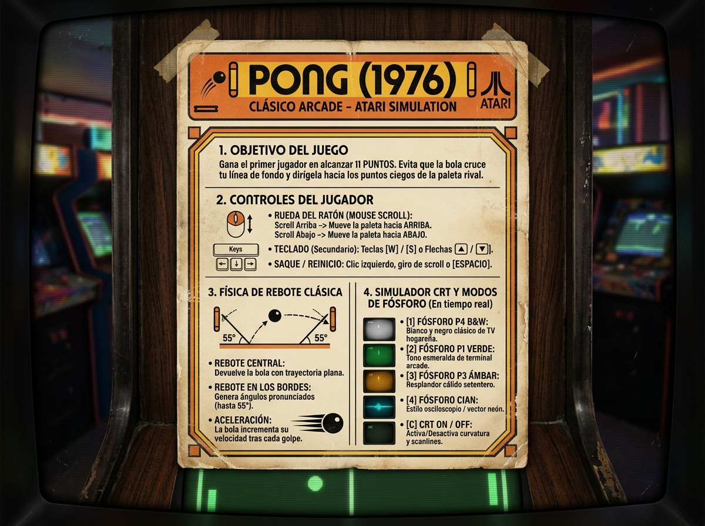

<div align="center">

# 🕹️ PONG — LA MAQUINITA DE LA FARMACIA
### *Un viaje en el tiempo a aquellas tardes gastando las monedas del domingo.*

<br/>



<br/>

[](https://godotengine.org)
[](https://godotengine.org)
[](https://github.com)
[](LICENSE)

</div>

---

## 🪙 Recordando Viejos Tiempos

> *"Había un ritual sagrado los domingos: juntar las pocas monedas del domingo que nos daban los papás o los abuelos, salir con los amigos a la calle y plantarse frente a la maquinita que tenían puesta en la farmacia de la esquina. El sonido de los beeps rebotando en las paredes, el resplandor de la pantalla de tubo en la penumbra y la emoción de retar al que ganaba para que no se le acabara la ficha."*

Este proyecto es un **homenaje de corazón a esa época dorada**. Desarrollado en **Godot 4**, recrea cada detalle sensorial de aquellas retas: el rebote matemático exacto, los beeps de 8 bits generados por onda cuadrada y el inolvidable vidrio curvo de los televisores catódicos con fósforo persistente.

---

## 🇲🇽 La Historia Real: Las Maquinitas Adaptadas en el México de los 70s

Muchos de nosotros no jugamos en un mueble oficial importado de Estados Unidos, sino en una maravilla del **ingenio mexicano**:

1. **La consola casera adentro**: A finales de los años 70, traer arcades originales de Atari a México era carísimo por los aranceles de importación. Lo que llegaba eran las consolas hogareñas tipo *Home Pong* (o consolas con el mítico chip *AY-3-8500*).
2. **El gabinete artesanal**: En talleres de carpintería y electrónica locales fabricaban gabinetes de madera o triplay, adaptando adentro una pequeña televisión portátil de bulbos o transistores en blanco y negro.
3. **El monedero adaptado**: Los técnicos desoldaban los potenciómetros de la consola para conectarlos a perillas gruesas en el panel exterior y le soldaban un **tragamonedas mecánico** (de aquellos viejos pesos o monedas de 20 centavos) con un relevador y temporizador que liberaba la señal por unos minutos por cada moneda.
4. **La farmacia o tiendita del barrio**: No hacía falta ir a un salón de juegos lujoso; la maquinita estaba ahí mismo, en la farmacia de la colonia, la miscelánea, la paletería o la papelería, donde se armaba la fila de chamacos para ver quién le quitaba el trono al que estaba jugando.

---

## ✨ Características Especiales

### 🎛️ Control Analógico con Scroll del Ratón
¿Recuerdas la perilla giratoria (*paddle knob*) del arcade? La hemos recreado usando la **rueda del ratón (Mouse Scroll)**. Cada giro de la rueda desplaza tu paleta con suavidad y precisión quirúrgica.

### 📺 Simulación Auténtica de Pantalla CRT
- **Scanlines de 240p**: El barrido horizontal del cañón de electrones tal como lo veían nuestros ojos.
- **Curvatura de Tubo (Barrel Distortion)**: Deformación esférica convexa del vidrio del televisor.
- **Aperture Grille & Viñeteado**: Sombra y máscara de fósforo en las esquinas del mueble.
- **Estela de Persistencia de Fósforo**: La bola deja una cola fantasmal luminosa al volar a toda velocidad, emulando el decaimiento químico del fósforo en la pantalla.
- **Glow en Paletas y Cancha**: Haz catódico que irradia luz suavemente.

### 🎨 Selector de Fósforo en Tiempo Real
Revive cómo se jugaba en distintos tipos de monitores clásicos pulsando una sola tecla:
- <kbd>1</kbd> **P4 Blanco y Negro Clásico**: El tono plateado/azulado de los primeros televisores de sala.
- <kbd>2</kbd> **P1 Fósforo Verde Arcade**: El icónico brillo verde esmeralda de las máquinas de arcade de salón.
- <kbd>3</kbd> **P3 Fósforo Ámbar Vintage**: Tono cálido dorado setentero.
- <kbd>4</kbd> **Fósforo Neón Cian**: Estilo monitor vector/láser.
- <kbd>C</kbd> **Activar / Desactivar CRT**: Alterna el filtro catódico al vuelo.
- <kbd>G</kbd> **Nivel de Glow**: Alterna entre resplandor *Suave*, *Estándar* y *Ultra Glow*.

### 🔊 Sonido 8-Bit 100% Procedural
Sin archivos MP3 o WAV descargados de internet. Los tres míticos beeps del Pong (paleta a 490 Hz, muro a 226 Hz y punto a 125 Hz) se sintetizan matemáticamente en la memoria de la máquina al instante.

### 🖼️ Cartel Exterior del Mueble
Al iniciar el juego te recibe la **portada exterior limpia y nítida** que decoraba el gabinete original de la farmacia. No tiene filtro de tubo porque representa el cartel físico de madera y plástico de afuera. Al hacer clic o presionar una tecla, el cartel se desvanece y entras al tubo encendido.

---

## 🕹️ Guía Rápida de Controles

| Situación | Acción | Control |
|---|---|---|
| **Portada Inicial** | **Entrar al juego** | **Haz clic**, toca la pantalla o pulsa cualquier tecla *(no scroll)* |
| **Durante el Juego** | **Mover tu Paleta** | **Gira la rueda del ratón (Mouse Scroll)** |
| **Control Alternativo**| **Mover Paleta** | Teclas <kbd>W</kbd> / <kbd>S</kbd> o Flechas <kbd>↑</kbd> / <kbd>↓</kbd> |
| **Saque / Pausa** | **Lanzar la bola** | Clic del ratón, giro de scroll o barra <kbd>Espacio</kbd> |
| **Cualquier Momento** | **Volver a Portada / Reset** | Presiona la tecla <kbd>ESC</kbd> |
| **Personalización** | **Color de Fósforo** | Teclas numéricas <kbd>1</kbd>, <kbd>2</kbd>, <kbd>3</kbd>, <kbd>4</kbd> |
| **Personalización** | **Filtro CRT On/Off** | Tecla <kbd>C</kbd> |
| **Personalización** | **Intensidad de Glow** | Tecla <kbd>G</kbd> |

---

## 🏆 Reglas del Juego

- **Primero a 11 Puntos Gana**: Regla oficial del Pong clásico de Atari.
- **Física Angular**: Si golpeas la bola con el **centro de tu paleta**, sale disparada recta; si la cortas con los **extremos**, toma ángulos inclinados de hasta **55°** para descolocar a la máquina.
- **Tensión Creciente**: Cada raquetazo exitoso acelera la bola un poco más.

---

## 🚀 Cómo Jugar

### Opción A: Desde Godot Engine
1. Descarga o clona este repositorio:
   ```bash
   git clone https://github.com/AbelVicencio/pong-1976-godot.git
   ```
2. Abre **Godot Engine 4** e importa la carpeta del proyecto.
3. Haz clic en **Ejecutar** (o pulsa <kbd>F5</kbd>).

### Opción B: Desde PowerShell / Terminal
Estando en la carpeta del juego:
```powershell
Godot.exe
```

---

## 🛠️ Tecnologías y Arquitectura

- **Motor**: Godot Engine 4.7+ (Renderizador Compatibility / OpenGL 3.3).
- **Lenguaje**: GDScript 2.0 (Tipado estático).
- **Shaders**: Godot Shading Language (GLSL CanvasItem).
- **Audio**: Síntesis directa en memoria mediante `AudioStreamWAV`.
- **Gráficos**: Primitivas vectoriales en GPU mediante la API `_draw()`.
- **Documentación para Programadores**: Consulta [**`pong.md`**](pong.md) para un desglose técnico paso a paso de la arquitectura del juego.

---

<div align="center">

*Dedicado a todos los que dejamos las monedas del domingo y parte de nuestra infancia frente a una maquinita.*  
**¡A jugar y a recordar! 🕹️**

</div>
